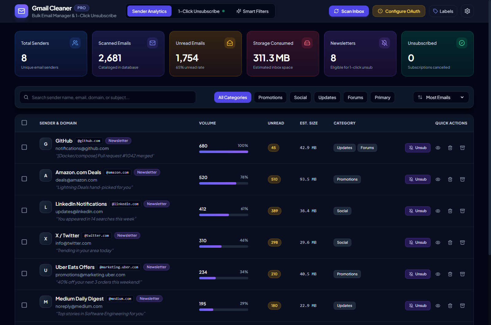
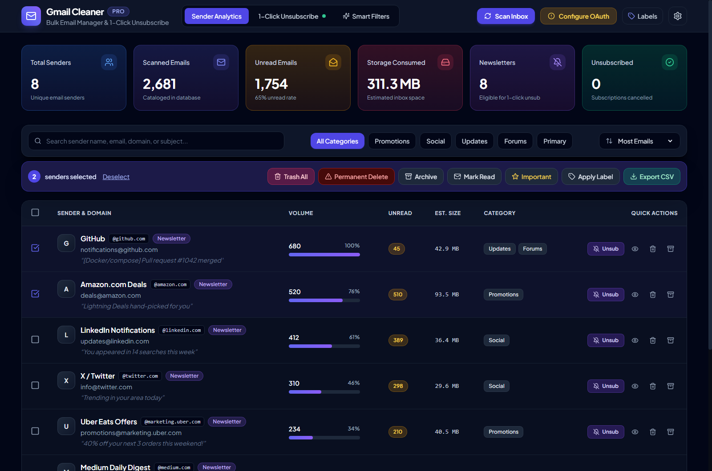
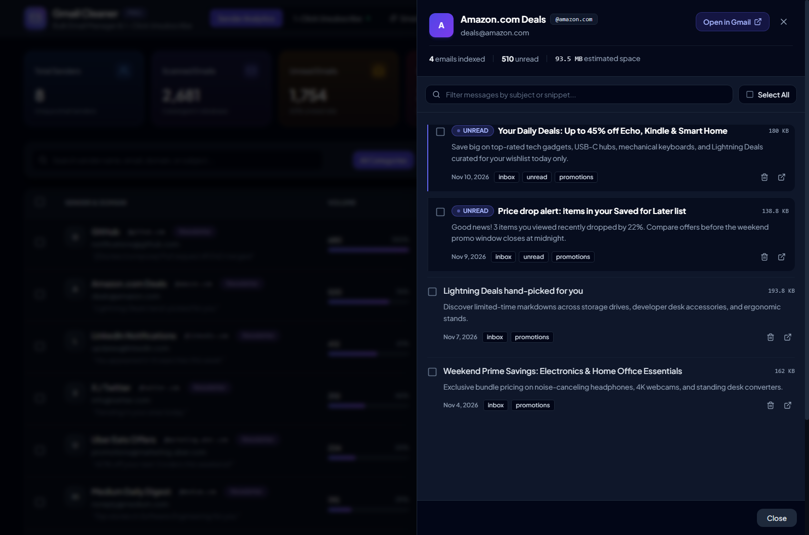
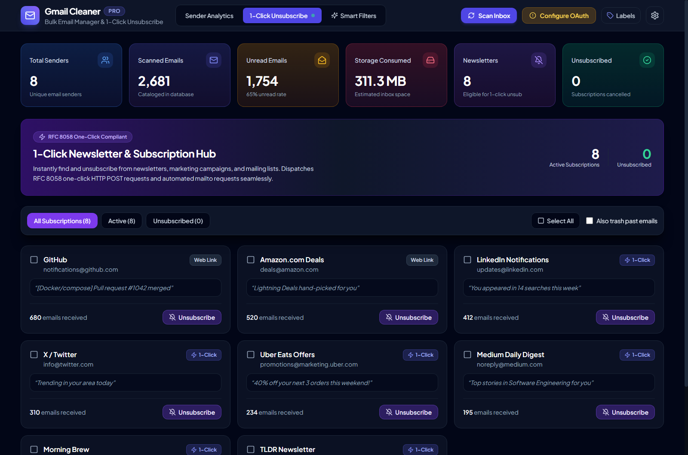
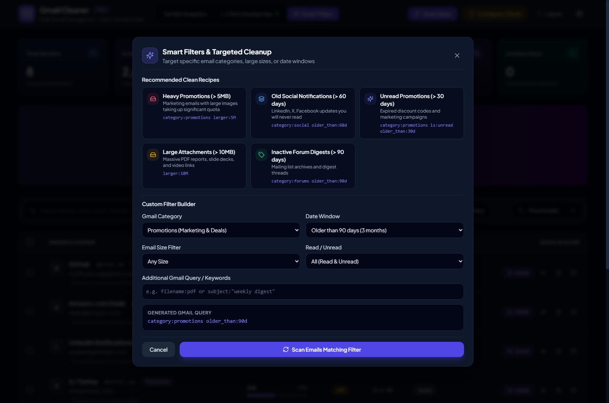

# Gmail Cleaner Pro

A 100% local, Dockerized bulk Gmail manager and newsletter unsubscribe web application. Scan thousands of emails into a fast local SQLite cache, inspect storage consumption by sender, mass-trash or archive clutter safely, and dispatch RFC 8058 one-click unsubscribes—without ever sending your emails or OAuth tokens to third-party servers.

> **Built with Google Gemini:** This project was designed, engineered, and tested entirely using **Google Gemini**.

---

## Table of Contents

- [Screenshots](#screenshots)
- [Features in Detail](#features-in-detail)
- [Quick Start: Docker (Recommended)](#quick-start-docker-recommended)
- [Running Locally (Windows, macOS & Linux)](#running-locally-windows-macos--linux)
  - [Windows (`start-local.bat` & `start-docker.bat`)](#windows-start-localbat--start-dockerbat)
  - [macOS & Linux (`start.sh`)](#macos--linux-startsh)
  - [Full Hot-Reload Development Mode](#full-hot-reload-development-mode)
- [Google Cloud OAuth Setup](#google-cloud-oauth-setup)
- [Environment Configuration](#environment-configuration)
- [Running Tests & Build Checks](#running-tests--build-checks)
- [Security & Privacy](#security--privacy)
- [Architecture](#architecture)
- [Contributing & License](#contributing--license)

---

## Screenshots

> Captured using built-in **Demo Mode** (`DEMO_MODE=true`) with synthetic sample data.

### Sender Analytics Dashboard
Overview KPIs, category filter pills, estimated inbox storage bars, and quick per-sender controls.



### Multi-Select Bulk Actions
Select multiple senders to run batch Archive, Trash, Unsubscribe, Mark as Read, or Permanent Delete operations from the floating toolbar.



### Email Inspector
Expand any sender to browse individual emails, preview snippets and storage sizes, and delete specific messages or entire batches.



### 1-Click Unsubscribe Hub
Dedicated workspace listing eligible newsletters and mailing lists with RFC 8058 HTTP POST / `mailto:` unsubscribe status tracking.



### Smart Filters & Targeted Cleanup
Preset cleanup recipes and an interactive Gmail query builder for targeting large attachments, unread promotions, or aging notifications.



---

## Features in Detail

### 1. High-Speed Batch Inbox Scanner
* **Google Batch API with Quota Backoff:** Fetches message metadata in batches of 25 via Gmail's `multipart/mixed` batch endpoint. Every sub-request status (`200`, `403`, `429`, `404`) is inspected individually—any throttled messages are automatically retried with exponential backoff and live progress notices so zero emails are silently dropped.
* **Incoming Mail Only Mode:** Enabled by default (`-in:sent -in:draft`) and excludes your own active email address so you do not accidentally clean messages you sent.
* **Flexible Scan Depth & Custom Queries:** Choose Quick (`500`), Standard (`1,500`), or Deep Clean (`5,000`) presets, narrow to a Gmail category, or pass any Gmail search query (`is:unread`, `older_than:60d`, etc.).
* **Incremental Persistence & Reset Cache:** Progress commits incrementally to SQLite (`WAL` mode) every 100 messages, and a **Reset Cache** action lets you clear local cached scan data cleanly at any time.

### 2. Sender Analytics Dashboard & Sticky Command Bar
* **KPI Overview Strip:** Displays live database totals for **Total Senders**, **Scanned Emails**, **Unread Emails** (with unread rate %), **Storage Consumed**, **Newsletters** (eligible for 1-click unsubscribe), and **Unsubscribed** counts.
* **Sticky Search, Filter & Bulk Controls:** Search senders by name, address, domain, or sample subject, filter by category pills (`Promotions`, `Social`, `Updates`, `Forums`, `Primary`), sort by email volume, unread count, storage size, name, or domain, and trigger bulk actions from a unified bar that stays pinned beneath the navigation bar as you scroll.

### 3. Slide-Over Email Inspector Drawer
* **Chronological Message Inspection:** Click any sender to open a slide-over drawer listing their individual messages (newest-first), including **UNREAD** badges, snippets, dates, labels, and size estimates.
* **Live Gmail Backfill & Direct Links:** Automatically fetches recent emails live from Gmail if fewer than 10 are cached for a sender, supports **Load More** pagination (`50` per page), filters messages inside the drawer, and links straight to the thread in Gmail.
* **Per-Message Controls:** Mark selected individual messages as read, move them to Trash, or permanently delete them—automatically synchronizing sender and dashboard totals.

### 4. 1-Click & Bulk Newsletter Unsubscribe Hub
* **Protocol Cascade:** Inspects `List-Unsubscribe` and `List-Unsubscribe-Post` headers to automatically dispatch:
  1. **RFC 8058 One-Click `POST`** (`List-Unsubscribe=One-Click`)
  2. **Automated `mailto:`** dispatch via the Gmail API
  3. **Safe HTTP `GET` / Web Link** fallback validated against internal/private IP ranges (SSRF protection)
* **Bulk Unsubscribe:** Select multiple newsletters in the hub, filter by `All`, `Active`, or `Unsubscribed`, optionally check **Also trash past emails**, and run bulk unsubscribes with live progress tracking.

### 5. Bulk Multi-Sender Cleanup & Label Management
* **Safe Trash Default vs. Permanent Delete:** Bulk **Trash** moves emails to Gmail's Trash folder (30-day recovery window). **Permanent Delete** (`batchDelete`) requires an explicit confirmation modal.
* **Archive, Mark Read & Importance:** Strip the `INBOX` label in bulk, clear unread badges, or flag/unflag `IMPORTANT` across selected senders.
* **Gmail Label Manager:** View system labels, create or delete custom Gmail user labels, and bulk-apply labels from either the table toolbar or the Label Manager modal.

### 6. Smart Filters & Cleanup Recipes
* **One-Click Cleanup Recipes:** Built-in presets for *Heavy Promotions (> 5MB)*, *Old Social Notifications (> 60 days)*, *Unread Promotions (> 30 days)*, *Large Attachments (> 10MB)*, and *Inactive Forum Digests (> 90 days)*.
* **Visual Query Builder:** Combine category, date window (`older_than:*`), minimum message size (`larger:*`), read/unread status, and custom keywords with live Gmail query preview.

### 7. CSV Export & Instant Demo Mode
* **CSV Metadata Reports:** Download filtered sender/message CSV reports (`Message ID`, `Sender Name`, `Sender Email`, `Subject`, `Size`, `Unsubscribe`, `Link`, `Snippet`) hardened against spreadsheet formula injection.
* **Demo / Preview Mode:** Open **Settings -> Seed Demo Data** at any time before configuring Google Cloud OAuth to populate sample senders and test simulated scans, bulk actions, and unsubscribes completely offline.

---

## Quick Start: Docker (Recommended)

Docker builds both the React/Vite frontend and FastAPI backend in one multi-stage container with persistent local storage in `./data`.

### 1. Clone & Prepare Environment
```bash
git clone https://github.com/njayasathya/gmail-cleaner-pro.git
cd gmail-cleaner-pro
cp .env.example .env
```

### 2. Launch the Container
* **Cross-platform CLI:**
  ```bash
  docker compose up -d
  ```
* **Windows:** Double-click **`start-docker.bat`** (starts Docker Compose and opens your browser).
* **macOS / Linux:**
  ```bash
  chmod +x start.sh
  ./start.sh docker
  ```

Open **[http://localhost:8000](http://localhost:8000)** in your browser. Data and tokens persist in `./data`.

---

## Running Locally (Windows, macOS & Linux)

You can run Gmail Cleaner Pro directly on your host machine without Docker using Python 3.11+ and Node.js 18+.

> **Important:** `start-local.bat` and `./start.sh local` serve the built UI bundle from `frontend/dist` at `http://localhost:8000`. Make sure to run `npm install && npm run build` inside `frontend/` once (and after any frontend edits).

### Windows (`start-local.bat` & `start-docker.bat`)

#### One-Time Local Setup (PowerShell or Command Prompt)
```powershell
# 1. Clone repository
git clone https://github.com/njayasathya/gmail-cleaner-pro.git
cd gmail-cleaner-pro
copy .env.example .env

# 2. Create Python virtual environment and install backend packages
python -m venv backend\.venv
backend\.venv\Scripts\pip install -r backend\requirements.txt

# 3. Install frontend dependencies and build production assets
npm --prefix frontend install
npm --prefix frontend run build
```

#### Launch Scripts on Windows
* **Local Mode (`start-local.bat`):** Double-click **`start-local.bat`** (or run `.\start-local.bat`) to launch `backend\run.py` using `backend\.venv` and open `http://localhost:8000`.
* **Docker Mode (`start-docker.bat`):** Double-click **`start-docker.bat`** (or run `.\start-docker.bat`) to start `docker compose up -d` and open `http://localhost:8000` (requires Docker Desktop running).

### macOS & Linux (`start.sh`)

#### One-Time Local Setup
```bash
# 1. Clone repository
git clone https://github.com/njayasathya/gmail-cleaner-pro.git
cd gmail-cleaner-pro
cp .env.example .env

# 2. Create Python virtual environment and install backend packages
python3 -m venv backend/.venv
backend/.venv/bin/pip install -r backend/requirements.txt

# 3. Install frontend dependencies and build production assets
npm --prefix frontend install
npm --prefix frontend run build

# 4. Make startup script executable
chmod +x start.sh
```

#### Using `start.sh`
```bash
# Auto-detect (uses Docker Compose if Docker daemon is running, otherwise falls back to backend/.venv)
./start.sh

# Explicitly run locally via Python virtual environment
./start.sh local

# Explicitly launch via Docker Compose
./start.sh docker
```

Once running, open **[http://localhost:8000](http://localhost:8000)**.

### Full Hot-Reload Development Mode

For active UI or backend development with instant reloading, run the backend API and Vite dev server in separate terminals:

**Terminal 1 — Backend API (`http://localhost:8000`):**
```bash
# Windows (PowerShell)
$env:DEBUG="true"; backend\.venv\Scripts\python backend/run.py

# macOS / Linux
DEBUG=true backend/.venv/bin/python backend/run.py
```

**Terminal 2 — Frontend Dev Server (`http://localhost:5173`):**
```bash
cd frontend
npm run dev
```

Vite automatically proxies `/api/*` requests to `http://localhost:8000`. FastAPI interactive API docs are available at `http://localhost:8000/docs`.

---

## Google Cloud OAuth Setup

To connect a real Gmail account, create your own OAuth 2.0 Client ID in the [Google Cloud Console](https://console.cloud.google.com/):

1. **Create a Project:** Open [Google Cloud Console](https://console.cloud.google.com/) and create a new project (e.g., `Gmail-Cleaner-Pro`).
2. **Enable Gmail API:** Go to **APIs & Services > Library**, search for **Gmail API**, and click **Enable**.
3. **Configure OAuth Consent Screen:**
   * Go to **APIs & Services > OAuth consent screen** and click **Get started**.
   * Enter App name (e.g., `gmail cleaner`) and User support email (your Gmail address), then click **Next**.
   * Under **Audience**, choose **External** and click **Next**.
   * Under **Contact Information**, enter your email address, click **Next**, and then click **Finish** and **Create**.
   * Once created, go to the **Audience** tab on the same page and add your Gmail address under **Test users**.
4. **Create OAuth Client:**
   * From the same screen, open the **Clients** tab and click **Create client**.
   * Select Application type: **Web application** and enter a client name (e.g., `gmail cleaner client 1`).
   * Add Authorized redirect URI:
     ```text
     http://localhost:8000/api/auth/callback
     ```
   * Click **Create**, then copy the **Client ID** and **Client secret** (or download the JSON file).
5. **Connect in the App:**
   * Either open **Settings** in the top navigation bar and enter your **Client ID** and **Client Secret**, OR set `GOOGLE_CLIENT_ID` / `GOOGLE_CLIENT_SECRET` in `.env`, OR place your downloaded file at `data/credentials.json`.
   * Click **Connect Gmail** and approve access.

> **Demo Mode Tip:** Click **Settings > Seed Demo Data** to load sample inbox analytics without configuring Google Cloud keys.

---

## Environment Configuration

Copy `.env.example` to `.env` to customize settings:

| Variable | Default | Description |
| :--- | :--- | :--- |
| `HOST` | `127.0.0.1` (`0.0.0.0` in Docker) | Bind interface for the FastAPI server. |
| `PORT` | `8000` | Port exposed by the backend server. |
| `DEBUG` | `false` | Enables Uvicorn auto-reload for backend development when `true`. |
| `GOOGLE_CLIENT_ID` | *(empty)* | Optional fallback if not saved via UI or `data/credentials.json`. |
| `GOOGLE_CLIENT_SECRET` | *(empty)* | Optional fallback if not saved via UI or `data/credentials.json`. |
| `GOOGLE_REDIRECT_URI` | `http://localhost:8000/api/auth/callback` | Must match the Authorized redirect URI configured in Google Cloud Console. |
| `DEMO_MODE` | `false` | Optional flag exposed in auth/stats metadata. |

---

## Running Tests & Build Checks

Install test dependencies once (`pip install -r backend/requirements-dev.txt`), then verify both backend and frontend:

```bash
# Backend unit & API tests (Windows PowerShell)
$env:PYTHONPATH="backend"; backend\.venv\Scripts\pytest backend\tests

# Backend unit & API tests (macOS / Linux)
PYTHONPATH=backend backend/.venv/bin/pytest backend/tests

# Frontend strict TypeScript check & production build
cd frontend
npx tsc --noUnusedLocals --noUnusedParameters --noEmit
npm run build
```

---

## Security & Privacy

* **100% Local Execution:** Credentials (`data/credentials.json`), OAuth tokens (`data/token.json`), PKCE verifiers (`data/oauth_state.json`), and scanned caches (`data/cleaner.db`) reside solely in `./data`, which is ignored by both `.gitignore` and `.dockerignore`.
* **Network Hardening:** Bare-metal runs bind strictly to `127.0.0.1` by default, CORS permits only local development/app origins (`localhost`/`127.0.0.1` on ports `8000` and `5173`), outbound `List-Unsubscribe` requests validate public IPs to block SSRF, and POSIX secret files are saved with `0600` permissions.
* **Data Safety:** Default bulk deletes move emails to Gmail's Trash; `Export CSV` escapes spreadsheet formula prefixes (`=`, `+`, `-`, `@`); SPA static serving checks path resolution boundaries.

See [SECURITY.md](SECURITY.md) for full details and vulnerability reporting instructions.

---

## Architecture

* **Frontend:** React 18, TypeScript, Vite 5, Tailwind CSS, Lucide Icons
* **Backend:** FastAPI, Uvicorn, Pydantic v2 Settings, SQLAlchemy 2 (Async), SQLite (`aiosqlite` in `WAL` mode), Server-Sent Events (`sse-starlette`), HTTPX async client
* **Gmail Integration:** Asynchronous Gmail REST API v1 client using Google HTTP Batch API (`multipart/mixed`), OAuth 2.0 with PKCE, and native `batchModify` / `batchDelete` endpoints

---

## Contributing & License

Contributions are welcome! Read [CONTRIBUTING.md](CONTRIBUTING.md) before opening a pull request.

Released under the [MIT License](LICENSE).
